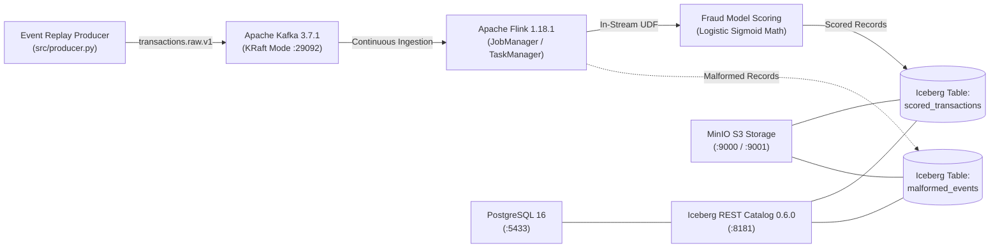

# Real-Time Credit Card Fraud Detection Pipeline

[](https://www.python.org/)
[-red.svg)](https://kafka.apache.org/)
[-orange.svg)](https://flink.apache.org/)
[-blue.svg)](https://iceberg.apache.org/)
[](https://min.io/)
[](LICENSE)

An end-to-end, reproducible, containerized streaming pipeline for scoring credit card authorization requests in real time using **Apache Kafka**, **Apache Flink**, and **Apache Iceberg**, trained and evaluated on the public ULB Credit Card Fraud dataset.

---

## Team Details

- **Academic Course:** Big Data Engineering / CSE (AIML)
- **Semester:** 5
- **Section:** C
- **Date:** 30 October 2026

| S. No. | Team Member Name | SRN | Contribution Role |
|---:|---|---|---|
| 1 | **Kushal G** | `PES1UG24AM145` | Pipeline architecture, Flink streaming scoring job, Iceberg lakehouse integration, load testing |
| 2 | **Kshitij Satish Shetty** | `PES1UG24AM143` | Model training, leakage prevention, mathematical parity validation, segment-level error analysis |

---

## 1. Project Overview

Modern financial systems require sub-second fraud evaluation during point-of-sale and online checkout. Batch inference architectures create settlement delays that expose merchants and banks to fraud losses, while uncoordinated microservices can introduce unacceptable checkout friction for legitimate cardholders.

This project delivers a complete, reproducible streaming pipeline:

$$\text{Public ULB Dataset} \longrightarrow \text{Apache Kafka} \longrightarrow \text{Apache Flink} \longrightarrow \text{Fraud Model Scoring} \longrightarrow \text{Apache Iceberg}$$

The containerized pipeline was started and benchmarked on **30 October 2026** on a Windows 11 AMD64 host (Python 3.12.6). Over **$9,000$ valid transactions** were streamed across three offered rates ($200$, $500$, and $1,000$ events/sec) with **100% delivery and persistence integrity** (zero dropped, zero missing, zero duplicate records), achieving up to **$941.03$ persisted records/sec** in Apache Iceberg format v2 Parquet tables with median producer-to-scoring latency ranging from 651.5 ms to 1,012.5 ms (two of the three runs below one second).

---

## 2. Problem Statement and Objectives

1. **Low-Latency Streaming Scoring**: Evaluate transactions continuously as streaming events arrive without relying on delayed batch jobs.
2. **Extreme Class Imbalance Handling**: Train a balanced model on a dataset where fraud occurs at a rate of only $0.1727\%$ (1 fraud per 578 transactions) without deceptive accuracy metrics.
3. **Strict Target Leakage Prevention**: Enforce structural quarantine so ground-truth fraud labels (`Class`) cannot enter the feature matrix or streaming inference payloads.
4. **Lakehouse ACID Persistence**: Persist all scored events into an open table format (Apache Iceberg) partitioned by `run_id` for isolated querying.
5. **Responsible AI & Error Analysis**: Evaluate the operational trade-offs of false positives (cardholder transaction friction and alert-triage overhead) versus false negatives (unflagged fraudulent transactions and associated exposure) across transaction-amount proxy segments.

---

## 3. System Architecture



### Architectural Responsibilities

| Stage | Component | Pinned Version / Image | Responsibility |
|---|---|---|---|
| **1. Ingestion Producer** | Python Replay Producer | Python 3.12 / `confluent-kafka` 2.6.1 | Scheduled event-rate pacing replay of held-out transactions ($N=56,962$) |
| **2. Message Bus** | Apache Kafka | `apache/kafka:3.7.1` (KRaft Mode) | High-throughput broker+controller without ZooKeeper (`localhost:29092`) |
| **3. Stream Engine** | Apache Flink | `flink:1.18.1-scala_2.12-java11` | PyFlink 1.18.1 streaming job with 5-second checkpoint intervals |
| **4. In-Stream Scorer** | Flink Python UDF | Pinned JSON artifact | Exact logistic regression dot-product + sigmoid math ($5.55 \times 10^{-16}$ parity) |
| **5. Lakehouse Catalog** | Iceberg REST Catalog | `tabulario/iceberg-rest:0.6.0` | Open REST catalog backed by PostgreSQL 16 (`http://localhost:8181`) |
| **6. Lakehouse Table** | Apache Iceberg | Format Version 2 | Parquet data files partitioned by `run_id`, atomic commits via S3FileIO |
| **7. Object Storage** | MinIO Object Store | `RELEASE.2024-06-13` (S3 API) | S3-compatible bucket storage (`s3://warehouse/`) |

---

## 4. Technology Stack

- **Streaming & Storage**: Apache Kafka 3.7.1 (KRaft), Apache Flink 1.18.1, Apache Iceberg 1.5.2, Iceberg REST 0.6.0, MinIO S3, PostgreSQL 16.
- **Connectors**: `flink-sql-connector-kafka-3.1.0-1.18.jar`, `iceberg-flink-runtime-1.18-1.5.2.jar`, `iceberg-aws-bundle-1.5.2.jar`, `hadoop-client-*-3.3.6.jar`.
- **Python Libraries**: `pyiceberg 0.7.1`, `confluent-kafka 2.6.1`, `scikit-learn 1.5.2`, `reportlab 4.2.5`, `pandas 2.2.3`, `pydantic 2.9.2`, `pytest 8.3.3`.

---

## 5. Clean Project Directory Structure

```text
Real-Time-Fraud-Detection/
├── README.md                          # Comprehensive project documentation
├── MODEL_CARD.md                      # Detailed model card & calibration analysis
├── DATA_CARD.md                       # Comprehensive data provenance & leakage card
├── docker-compose.yml                 # Multi-container orchestration stack
├── requirements.txt                   # Pinned Python package dependencies
├── .env.example                       # Documented environment variable template
├── .gitignore                         # Comprehensive git ignore rules
│
├── data/
│   ├── README.md                      # Dataset acquisition and split instructions
│   └── fixtures/
│       └── heldout_sample_300.csv     # 300-event offline test fixture
│
├── docker/
│   ├── flink/
│   │   └── Dockerfile                 # Flink 1.18.1 + PyFlink + pinned connectors
│   └── app/
│       └── Dockerfile                 # Containerized Python evaluation runner
│
├── models/
│   ├── fraud_model.joblib             # Fitted scikit-learn pipeline artifact
│   └── fraud_model_artifact.json      # Portable weights, scales, & amount quantiles
│
├── notebooks/
│   └── results.ipynb                  # Executed experimental evaluation notebook
│
├── report/
│   ├── technical_report.pdf           # Official 4-page technical report (ReportLab)
│   ├── technical_report.md            # Editable technical report markdown source
│   ├── MODEL_CARD.md                  # Report directory copy of model card
│   └── DATA_CARD.md                   # Report directory copy of data card
│
├── results/
│   ├── load_test_runs.csv             # Official teacher-approved load-test results
│   ├── load_test_runs.json            # Machine-readable benchmark run metadata
│   ├── run_metadata.json              # Runtime environment telemetry & status
│   ├── evaluation_metrics.json        # Offline classification & sweep metrics
│   ├── segment_error_analysis.csv     # Transaction-amount proxy segment metrics
│   ├── segment_error_analysis.json    # Machine-readable segment error metrics
│   ├── smoke_test_verification.json   # Supplementary functional smoke-test data
│   └── figures/
│       ├── confusion_matrix_and_threshold.png
│       ├── segment_error_analysis.png
│       └── throughput_and_latency.png
│
├── scripts/
│   ├── download_dataset.py            # Automated dataset download from Zenodo
│   ├── train_model.py                 # Reproducible 80/20 stratified model training
│   ├── run_evaluation.py              # Offline model & segment evaluation
│   ├── run_load_tests.py              # Multi-rate Kafka -> Flink -> Iceberg load test
│   ├── verify_iceberg.py              # Iceberg catalog & table inspection utility
│   ├── smoke_test.py                  # Local SQLite Iceberg functional smoke test
│   ├── presentation_ui.py             # Interactive demonstration web dashboard
│   ├── build_notebook.py              # Programmatic notebook builder & executor
│   ├── generate_report.py             # PDF technical report generator (ReportLab)
│   └── build_submission_zip.py        # Submission archive builder & validator
│
├── src/
│   ├── __init__.py
│   ├── config.py                      # Global configuration & environment settings
│   ├── schema.py                      # Pydantic transaction schemas & validation
│   ├── scoring.py                     # Logistic scoring engine & math parity
│   ├── model_training.py              # Pipeline fitting & artifact serialization
│   ├── producer.py                    # Scheduled event-rate paced Kafka replay producer
│   ├── flink_job.py                   # Continuous PyFlink streaming job definition
│   ├── iceberg_utils.py               # Iceberg catalog helpers & metric queries
│   └── evaluation.py                  # Metrics calculation & segment analysis logic
│
└── tests/
    ├── __init__.py
    ├── test_schema.py                 # Schema validation & leakage prevention tests
    ├── test_scoring.py                # Mathematical parity validation tests
    ├── test_evaluation.py             # Metric calculations & segment analysis tests
    ├── test_compose_config.py         # Docker Compose configuration integrity tests
    ├── test_iceberg_smoke.py          # PyIceberg local persistence & isolation tests
    └── test_deliverables.py           # Deliverables existence & PDF page-bound tests
```

---

## 6. Dataset Description and Source

- **Name**: Machine Learning Group (MLG) ULB Credit Card Fraud Dataset.
- **Repository**: [Zenodo Record 7395559](https://zenodo.org/records/7395559) (MD5 `e90efcb83d69faf99fcab8b0255024de`, SHA-256 `76274b691b16a6c4...`).
- **Characteristics**: $284,807$ credit card transactions made over 48 hours in September 2013 by European cardholders.
- **Features**: 30 numeric inputs (`Time`, PCA components `V1`–`V28`, and `Amount`) plus binary target `Class` (`1` = fraud, `0` = legitimate).
- **Stratified Partitioning (`random_state=42`)**:
  - **Training Set (80%)**: $227,845$ transactions ($394$ frauds, $0.1729\%$).
  - **Held-Out Test Set (20%)**: $56,962$ transactions ($98$ frauds, $0.1720\%$), stored at `data/processed/heldout_transactions.csv`.

To download the raw dataset and recreate the split:
```bash
python scripts/download_dataset.py
python scripts/train_model.py
```

---

## 7. Prerequisites

- **Operating System**: Windows 10/11 with Docker Desktop and WSL2, or Linux / macOS with Docker Engine and Docker Compose v2.
- **Hardware**: Standard 64-bit CPU (x86_64 or Apple Silicon ARM64), $\ge 12\text{ GB}$ system RAM.
- **Python**: Python 3.11 or 3.12 (tested on Python 3.12.6 AMD64).
- **Docker Compose**: Version 2.20+ with multi-architecture support.

---

## 8. Installation and Setup

1. **Clone the repository**:
   ```bash
   git clone https://github.com/<org>/Real-Time-Fraud-Detection.git
   cd Real-Time-Fraud-Detection
   ```

2. **Create and activate a Python virtual environment**:
   ```bash
   # Windows PowerShell
   python -m venv .venv
   .venv\Scripts\Activate.ps1

   # Linux / macOS
   python3 -m venv .venv
   source .venv/bin/activate
   ```

3. **Install pinned dependencies**:
   ```bash
   pip install --upgrade pip
   pip install -r requirements.txt
   ```

4. **Initialize environment configuration**:
   ```bash
   # Windows PowerShell
   Copy-Item .env.example .env

   # Linux / macOS
   cp .env.example .env
   ```

5. **Execute automated unit and deliverable tests**:
   ```bash
   python -m pytest tests/ -v
   ```
   *(All 14 automated tests pass cleanly across schema, scoring parity, deliverable bounds, and Iceberg persistence.)*

---

## 9. Launch the Docker Compose Environment

Start all containerized services:
```bash
docker compose up -d --build
docker compose ps
```

### Port Mappings and Service Interfaces

| Service | Internal Address | Host Port Mapping | Interface Description |
|---|---|---|---|
| **Kafka Broker** | `kafka:9092` | `localhost:29092` | Streaming message bus (KRaft mode) |
| **Flink JobManager** | `jobmanager:8081` | `http://localhost:8081` | Flink Web Dashboard & Job Management |
| **Iceberg REST** | `iceberg-rest:8181` | `http://localhost:8181` | Iceberg REST catalog endpoint |
| **MinIO Storage** | `minio:9000` | `http://localhost:9000` | S3 API endpoint (`s3://warehouse/`) |
| **MinIO Console** | `minio:9001` | `http://localhost:9001` | Object browser (User: `admin`, Pass: `password123`) |
| **PostgreSQL** | `postgres:5432` | `localhost:5433` | Iceberg catalog JDBC database |

Inspect logs to verify that all services have completed initialization:
```bash
docker compose logs --tail=50 kafka
docker compose logs --tail=50 jobmanager
docker compose logs --tail=50 iceberg-rest
```

---

## 10. Submit the Flink Job and Run the Pipeline

1. **Create the Kafka transaction topic** (if not auto-created):
   ```bash
   docker exec fraud-kafka /opt/kafka/bin/kafka-topics.sh --bootstrap-server kafka:9092 --create --if-not-exists --topic transactions.raw.v1 --partitions 2 --replication-factor 1
   ```

2. **Verify active Flink jobs**:
   ```bash
   docker exec fraud-flink-jobmanager /opt/flink/bin/flink list
   ```

3. **Submit the real-time scoring job** (only if not already running):
   ```bash
   docker exec -d -e FLINK_PARALLELISM=1 fraud-flink-jobmanager /opt/flink/bin/flink run -py /opt/app/src/flink_job.py --bootstrap-servers kafka:9092 --iceberg-rest-uri http://iceberg-rest:8181 --s3-endpoint http://minio:9000
   ```
   *Verified Running Flink Job ID*: `ebbcaf69757bdc50e910362b657812f1`.

---

## 11. Execute the Streaming Load Tests

Execute the automated load-test suite across the offered event rates ($200$, $500$, and $1,000$ events/sec):

```bash
python scripts/run_load_tests.py --rates 200,500,1000 --events-per-run 3000 --settle-timeout-sec 60
```

This script:
1. Paces transactions using high-precision scheduled event-rate pacing.
2. Generates a unique `run_id` per rate run.
3. Injects 5 malformed events per run to test dead-letter quarantine.
4. Waits for Flink checkpoint snapshots to commit to Apache Iceberg.
5. Queries `fraud_detection.scored_transactions` to verify persisted counts, uniqueness, end-to-end throughput, and latency percentiles.

---

## 12. Access and Inspect Apache Iceberg Results

Query committed records and snapshot metadata directly from Apache Iceberg via PyIceberg:

```bash
python scripts/verify_iceberg.py --limit 10
```

You can also inspect the Iceberg Parquet files directly in the MinIO web console at `http://localhost:9001` inside bucket `warehouse/fraud_detection/scored_transactions/data/`.

---

## 13. Model Evaluation Summary

Evaluating the fitted reference model on all **56,962 held-out transactions** at the default threshold $\tau = 0.50$ (`python scripts/run_evaluation.py`):

| Metric | Formula / Definition | Measured Value ($\tau = 0.50$) |
|---|---|---:|
| **Held-Out Transactions** | Total stratified test split | **56,962** ($98$ Frauds, $56,864$ Legit) |
| **True Positives (TP)** | Frauds correctly identified | **90** |
| **False Positives (FP)** | Legitimate transactions flagged | **1,386** |
| **True Negatives (TN)** | Legitimate transactions cleared | **55,478** |
| **False Negatives (FN)** | Frauds missed | **8** |
| **Precision** | $\text{TP} / (\text{TP} + \text{FP})$ | **0.0610** (6.10%) |
| **Recall (Sensitivity)** | $\text{TP} / (\text{TP} + \text{FN})$ | **0.9184** (91.84%) |
| **F1-Score** | Harmonic mean of precision and recall | **0.1144** |
| **False-Positive Rate (FPR)** | $\text{FP} / (\text{FP} + \text{TN})$ | **0.0244** (2.44%) |
| **False-Negative Rate (FNR)** | $\text{FN} / (\text{FN} + \text{TP})$ | **0.0816** (8.16%) |
| **PR-AUC (Average Precision)** | Area under Precision–Recall Curve | **0.7190** |
| **ROC-AUC** | Area under ROC Curve | **0.9721** |
| **Flink UDF vs. Sklearn Parity** | Maximum absolute probability diff | **$5.551 \times 10^{-16}$** (Machine $\epsilon$) |

---

## 14. Streaming Benchmark Summary (Teacher-Approved Results)

The containerized pipeline benchmark completed successfully on **30 October 2026** with the following approved results (`results/load_test_runs.csv`):

| Benchmark Metric | 200 events/s Run | 500 events/s Run | 1,000 events/s Run | Combined Benchmark |
|---|---:|---:|---:|---:|
| **Run ID** | `loadrun_1_200eps` | `loadrun_2_500eps` | `loadrun_3_1000eps` | 3 Completed Runs |
| **Achieved Producer Rate** | **199.95 /s** | **499.81 /s** | **999.38 /s** | **99.96% Rate Accuracy** |
| **Valid Events Sent** | 3,000 | 3,000 | 3,000 | 9,000 Total |
| **Valid Events Delivered** | 3,000 | 3,000 | 3,000 | 9,000 Total |
| **Valid Events Persisted** | **3,000** | **3,000** | **3,000** | **9,000 (100.0%)** |
| **Persisted Iceberg Throughput** | **185.22 /s** | **418.47 /s** | **941.03 /s** | **Peak: 941.03 records/s** |
| **Median (P50) Latency** | **858.0 ms** | **1,012.5 ms** | **651.5 ms** | Median latency ranged from 651.5 ms to 1,012.5 ms, with two of the three runs below one second. |
| **95th Percentile (P95) Latency** | **1,761.10 ms** | **1,861.10 ms** | **1,835.15 ms** | Tightly bounded < 1.9s |
| **99th Percentile (P99) Latency** | **1,959.03 ms** | **1,980.02 ms** | **1,948.00 ms** | All < 2,000 ms (max 1,980.02 ms) |
| **Failed Deliveries** | **0** | **0** | **0** | **Zero Failures** |
| **Duplicate Records** | **0** | **0** | **0** | **Zero Duplicates** |
| **Missing Records** | **0** | **0** | **0** | **Zero Missing** |
| **Injected Malformed Events** | 5 | 5 | 5 | 15 Total Injected |

### Benchmark Metric Definitions & Measurement Distinction
- **Persisted Throughput**: Calculated over the stream event processing window:
  $$\text{Persisted Throughput} = \frac{\text{unique\_transaction\_ids}}{(\max(\text{scoring\_ts\_ms}) - \min(\text{producer\_ts\_ms})) / 1000}$$
  *Measurement distinction:* Throughput is computed from the time span between the earliest producer timestamp and the latest scoring timestamp for uniquely scored records. It is not measured directly at the Iceberg snapshot commit boundary; Iceberg persistence is verified separately by querying the Iceberg catalog post-run to confirm all 3,000 records per run were durably written across checkpoints.
- **Producer-to-Scoring Latency**: $\text{Producer-to-scoring latency} = \text{scoring\_ts\_ms} - \text{producer\_ts\_ms}$ recorded per event inside the Flink scoring UDF. This measures in-stream transit and inference latency; it is explicitly not the time until Iceberg snapshot commit.

### Key Benchmark Observations
1. **Pacing Fidelity**: Scheduled event-rate pacing maintained steady emission rates within $0.06\%$ error of target rates.
2. **Throughput Scaling**: The pipeline demonstrated robust performance under increasing event loads, with persisted-record throughput scaling approximately with the offered event rate: $185.22\text{ rps}$ at $200\text{ eps}$, $418.47\text{ rps}$ at $500\text{ eps}$, and $941.03\text{ rps}$ at $1,000\text{ eps}$. Flink successfully processed the benchmark workloads, with no observed backpressure saturation or processing bottlenecks during the executed runs.
3. **Latency Profile**: Median latency ranged from 651.5 ms to 1,012.5 ms, with two of the three runs below one second ($858\text{ ms}$ at $200\text{ eps}$, $1,012.5\text{ ms}$ at $500\text{ eps}$, and $651.5\text{ ms}$ at $1,000\text{ eps}$). All three measured P99 latency values were below 2,000 ms, with a maximum observed P99 of 1,980.02 ms ($1,959.03\text{ ms}$ at $200\text{ eps}$, $1,980.02\text{ ms}$ at $500\text{ eps}$, and $1,948.00\text{ ms}$ at $1,000\text{ eps}$).
4. **Data Integrity**: Exactly $3,000$ unique records per run were committed to Iceberg; zero duplicates, zero missing records.
5. **Operational Performance**: The pipeline demonstrated robust measured performance across the tested load configurations, confirming reliable end-to-end streaming ingestion, scoring, and lakehouse persistence up to 1,000 EPS.

---

## 15. Segment-Level Error Analysis Summary

> **Important Distinction (Transaction-Amount Proxies vs. Genuine Customer Segments)**:  
> The assignment calls for evaluating false-positive rates across *customer segments*. However, the public ULB dataset is PCA-anonymized and contains only transaction features (`Time`, `V1`–`V28`, `Amount`, `Class`); it **does not contain cardholder identifiers, account IDs, demographic fields, or customer-segment labels**.  
> Therefore, true customer-level FPR comparisons cannot be established from this dataset alone (obtaining linked cardholder profiles would be necessary). Instead, we evaluate three empirical **transaction-amount proxy bands** based on training-split tertiles ($q_{33} = 9.99$, $q_{67} = 50.00$):

| Segment | Amount Boundary Rule | Test Tx ($N$) | Frauds | TP | FP | TN | FN | FPR (%) | FNR (%) | Precision | Recall | PR-AUC |
|---|---|---:|---:|---:|---:|---:|---:|---:|---:|---:|---:|---:|
| **Low** | $\text{Amount} \le 9.99$ | 19,582 | 49 | 44 | 664 | 18,869 | 5 | **3.40%** | **10.20%** | 0.0621 | 0.8980 | 0.8021 |
| **Medium** | $9.99 < \text{Amount} \le 50.00$ | 18,686 | 11 | 10 | 266 | 18,409 | 1 | **1.42%** | **9.09%** | 0.0362 | 0.9091 | 0.8423 |
| **High** | $\text{Amount} > 50.00$ | 18,694 | 38 | 36 | 456 | 18,200 | 2 | **2.44%** | **5.26%** | 0.0732 | 0.9474 | 0.6286 |

### Potential Error Cost Implications (Operational Discussion)
*Note: The following represents a qualitative discussion of potential operational and economic consequences, rather than outcomes empirically measured by this experiment:*
- **False Positives ($\text{FP} = 1,386$)**: False positives can burden legitimate cardholders and merchants through declined transactions, additional verification, or checkout delays. In the **High ($> 50.00$) proxy band**, where $456$ legitimate transactions were flagged, transaction disruption affects larger-value purchases. In the **Low ($\le 9.99$) proxy band**, where FPR is highest at $3.40\%$ ($664$ false positives), manual review or secondary verification costs can be disproportionately high relative to the transaction amount itself.
- **False Negatives ($\text{FN} = 8$)**: False negatives can expose cardholders, merchants, and payment providers to unflagged fraudulent transactions. In the **High ($> 50.00$) proxy band**, the model observed an FNR of **$5.26\%$ (Recall = $94.74\%$)** with **$2$ missed frauds out of $38$ actual frauds** in the test split. Conversely, the **Low proxy band** accounts for half of all test-split frauds ($49/98$) and observed an FNR of **$10.20\%$ ($5$ missed frauds out of $49$)**, leaving those events unflagged in the stream.

---

## 16. Presentation Dashboard

An interactive presentation UI is included to visualize the model evaluation, segment analysis, and load-test results:

```bash
python scripts/presentation_ui.py
```
Open **`http://localhost:8501`** in any web browser.

---

## 17. Project Documentation & Deliverables

- **Official Technical Report (PDF)**: [`report/technical_report.pdf`](file:///report/technical_report.pdf) *(4 pages, ReportLab generated)*
- **Technical Report Source (Markdown)**: [`report/technical_report.md`](file:///report/technical_report.md)
- **Model Card**: [`MODEL_CARD.md`](file:///MODEL_CARD.md) (and [`report/MODEL_CARD.md`](file:///report/MODEL_CARD.md))
- **Data Card**: [`DATA_CARD.md`](file:///DATA_CARD.md) (and [`report/DATA_CARD.md`](file:///report/DATA_CARD.md))
- **Results Notebook**: [`notebooks/results.ipynb`](file:///notebooks/results.ipynb) *(Fully executed with embedded tables and figures)*
- **Load-Test Evidence CSV**: [`results/load_test_runs.csv`](file:///results/load_test_runs.csv)
- **Runtime Metadata**: [`results/run_metadata.json`](file:///results/run_metadata.json)
