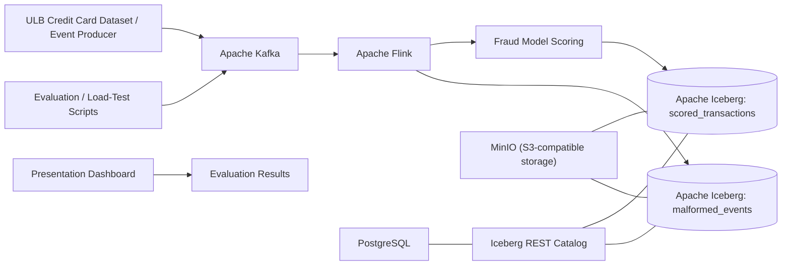

# Real-Time Credit Card Fraud Detection Pipeline

A reproducible streaming pipeline for scoring credit-card transactions using **Apache Kafka**, **Apache Flink**, and **Apache Iceberg**. The project uses the public ULB Credit Card Fraud Detection dataset and includes model evaluation, smoke-test tooling, load-test scripts, and a presentation dashboard.

## 1. Architecture



### Main components

| Component | Role |
|---|---|
| Event producer | Replays held-out transactions and can pace events at a configured rate |
| Apache Kafka | Buffers transaction events for streaming consumption |
| Apache Flink | Consumes, validates, scores, and routes malformed events separately |
| Fraud model | Logistic-regression scoring using the exported model artifact |
| Apache Iceberg | Persists scored transactions and malformed events |
| Iceberg REST catalog + PostgreSQL | Catalog and metadata services |
| MinIO | Local S3-compatible storage for Iceberg data |
| Evaluation scripts / notebook | Model metrics and performance evidence |
| Presentation UI | Displays evaluation results for demonstration |

## 2. Requirements

- Windows 10/11 with Docker Desktop and WSL2 enabled, or Linux/macOS with Docker Engine and Docker Compose v2.
- Python 3.11 or newer (the project was tested with Python 3.12).
- Allow Docker sufficient memory; requirements depend on the host and Compose configuration.

Verify installations:

```cmd
docker --version
docker compose version
python --version
```

## 3. Setup

Run commands from the repository root (the folder containing `docker-compose.yml`).

### Create a Python environment

Windows CMD:

```cmd
python -m venv .venv
.venv\Scripts\activate
python -m pip install --upgrade pip
pip install -r requirements.txt
```

If `.venv` already exists, activate it instead of creating another one.

### Dataset and model files

Place the ULB dataset at `data/raw/creditcard.csv` if reproducing dataset preparation or training. Large raw and processed CSV files are intentionally excluded from version control by `.gitignore`. Follow the repository's data instructions and scripts for the expected preprocessing workflow.

The streaming scorer uses the exported model artifact under `models/`. Do not commit credentials, local `.env` files, or large raw datasets.

## 4. Start the streaming stack

Build and start Docker Compose:

```cmd
docker compose up -d --build
docker compose ps
```

Wait for core services to become healthy. Inspect logs if needed:

```cmd
docker compose logs --tail=100 kafka
docker compose logs --tail=100 jobmanager
docker compose logs --tail=100 taskmanager
docker compose logs --tail=100 iceberg-rest
```

### Submit the Flink job

Check whether the job is already running:

```cmd
docker exec fraud-flink-jobmanager /opt/flink/bin/flink list
```

If the fraud-scoring job is listed as `RUNNING`, **do not submit a duplicate**. If no job is running, submit it once:

```cmd
docker exec -d -e FLINK_PARALLELISM=1 fraud-flink-jobmanager /opt/flink/bin/flink run -py /opt/app/src/flink_job.py --bootstrap-servers kafka:9092 --iceberg-rest-uri http://iceberg-rest:8181 --s3-endpoint http://minio:9000
```

Check the job list again and inspect logs if it does not start successfully.

## 5. Run verification and evaluation

Activate the Python virtual environment first if you are using one.

### Automated tests

```cmd
python -m pytest -q
```

### Smoke test

```cmd
python scripts\smoke_test.py
```

Read the output carefully and distinguish a local smoke test from a live Docker-cluster test.

### Model evaluation

```cmd
python scripts\run_evaluation.py
```

The held-out evaluation reports precision, recall, F1-score, false-positive rate, PR-AUC, and ROC-AUC. Previously recorded results at threshold 0.50 were:

- Held-out transactions: 56,962
- Precision: 6.10%
- Recall: 91.84%
- F1-score: 0.1144
- False-positive rate: 2.44%
- PR-AUC: 0.7190
- ROC-AUC: 0.9721

Fraud is rare, so high recall comes with false positives. Discuss precision-recall and threshold trade-offs; do not present these metrics as proof of production readiness.

### Load tests

Run load tests only when the Docker services and Flink job are ready:

```cmd
python scripts\run_load_tests.py
```

Check supported options with the script's help output before using custom rates or event counts. Report only measurements actually produced by the run. Distinguish offered event rate, achieved producer rate, end-to-end throughput, latency, and records confirmed persisted in Iceberg.

## 6. Presentation dashboard

Start the presentation UI in a separate terminal:

```cmd
python scripts\presentation_ui.py
```

Open `http://localhost:8501`.

This UI presents evaluation results. Demonstrate the live Kafka/Flink/Iceberg pipeline separately using `docker compose ps`, the Flink job list or Web UI, service logs, and persisted table results. The evaluation dashboard alone does not prove live streaming.

## 7. Results notebook and report

- Results notebook: `notebooks/results.ipynb`
- Technical report: `report/technical_report.pdf`
- Editable report source: `report/technical_report.md`
- Model card: `MODEL_CARD.md`

Review notebook outputs before submission. Ensure the report's description of Docker availability and load-test results matches the measurements actually verified on the final machine.

## 8. Useful URLs

When the stack is running, these interfaces may be available according to the port mappings in `docker-compose.yml`:

- Presentation UI: `http://localhost:8501`
- Flink Web UI: `http://localhost:8081`
- MinIO console: check the port mapping in `docker-compose.yml`

If an interface does not open, check `docker compose ps` and the relevant service logs.

## 9. Stop and restart safely

Stop running services while preserving containers and persistent volumes:

```cmd
docker compose stop
```

Restart them later:

```cmd
docker compose up -d
docker compose ps
docker exec fraud-flink-jobmanager /opt/flink/bin/flink list
```

Start the dashboard again in a separate terminal with `python scripts\presentation_ui.py`.

**Important:** Do not use `docker compose down -v` for a normal shutdown. The `-v` option removes Compose-managed volumes and may delete persistent catalog or data state. Use it only when you intentionally want to delete that data and have verified backups.

## 10. Repository hygiene

Before packaging the project:

- Exclude `.venv/`, Python caches, `.env`, local runtime volumes, and large raw/processed datasets.
- Keep source code, Docker configuration, tests, model artifact, notebook, technical report, and model card.
- Include small results files that support your claims, where appropriate.
- Do not include passwords, API keys, or other secrets.
- Re-run tests and inspect the ZIP contents before submission.

## 11. Limitations

- The ULB dataset does not provide genuine customer identities or merchant categories; transaction-amount bands are proxies, not demographic segments.
- The model scores transactions independently and does not use customer-level velocity windows.
- A local smoke test and a live containerized load test are different forms of evidence. State clearly which one produced each reported result.
- This is an academic prototype, not a production payment authorization system; further validation, monitoring, security controls, and operational testing would be needed.
