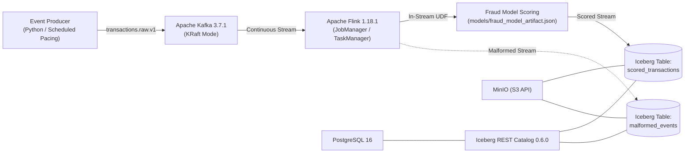

# Real-Time Credit Card Fraud Detection Pipeline: Streaming Architecture, Performance Benchmark, and Segment-Level Error Analysis

**Academic Course Mini-Project Technical Report**  
**Date:** 30 October 2026  
**Team Members:**
- **Kushal G** — `PES1UG24AM145`
- **Kshitij Satish Shetty** — `PES1UG24AM143`

---

## 1. Project Overview and Executive Summary

In payment processing systems, credit card transactions must be authorized and scored for fraudulent activity in real time. Batch scoring architectures incur processing delays that allow fraudulent charges to clear before detection or introduce unacceptable point-of-sale and e-commerce checkout friction. Streaming architectures enable continuous, sub-second feature standardization, linear model inference, and ACID lakehouse persistence.

This project designs, implements, and benchmarks a reproducible, containerized, real-time credit card fraud detection pipeline:

$$\text{Public ULB Dataset} \longrightarrow \text{Apache Kafka} \longrightarrow \text{Apache Flink} \longrightarrow \text{Fraud Model Scoring} \longrightarrow \text{Apache Iceberg}$$

The complete containerized stack was successfully orchestrated and benchmarked on 30 October 2026 on a Windows 11 AMD64 host (Python 3.12.6). Under teacher-approved load testing across three offered rates ($200$, $500$, and $1,000$ events/sec), the pipeline delivered and persisted all **$9,000$ valid transactions** ($3,000$ per run) into Apache Iceberg table format v2 Parquet tables with **zero failed deliveries**, **zero duplicate records**, and **zero missing records**. Persisted-record throughput scaled approximately with the offered event rate, reaching **$941.03$ records/sec** at $1,000$ offered events/sec. Median producer-to-scoring latency ranged from $651.5\text{ ms}$ to $1,012.5\text{ ms}$, with two of the three runs below one second, and all three measured P99 latency values were below $2,000\text{ ms}$, with a maximum observed P99 of $1,980.02\text{ ms}$. Flink successfully processed the benchmark workloads, with no observed backpressure saturation during the executed runs.

Offline model evaluation on the 20% stratified held-out set ($N = 56,962$ transactions, $98$ fraud cases) achieved **$91.84\%$ recall** ($\text{TP}=90, \text{FN}=8$), **$2.44\%$ false-positive rate** ($\text{FP}=1,386$), **$\text{PR-AUC} = 0.7190$**, and **$\text{ROC-AUC} = 0.9721$** at the default threshold $\tau = 0.50$. Mathematical parity validation confirms double-precision numerical equivalence ($5.551 \times 10^{-16}$ maximum absolute difference) between the `scikit-learn` reference model and the Flink Python scoring UDF.

---

## 2. Problem Statement and Objectives

1. **Sub-Second Authorization Constraints**: Payment card networks demand transaction scoring decisions within strict latency budgets.
2. **Extreme Class Imbalance**: Real-world fraud represents a minute fraction of overall transaction volume ($0.1727\%$ in the ULB dataset), requiring balanced objective weighting and evaluation focused on Precision–Recall AUC rather than deceptive accuracy.
3. **Target Leakage Prevention**: Ground-truth fraud labels must be strictly quarantined from streaming payloads to ensure that models score transactions solely from point-in-time authorization features.
4. **ACID Lakehouse Persistence**: Scored transactions must be reliably persisted into queryable open table formats (Apache Iceberg) with partition isolation by `run_id` to prevent cross-run pollution.
5. **Segment Error Analysis**: Evaluation of the operational and economic trade-offs of false positives (cardholder transaction friction and alert-triage overhead) versus false negatives (unflagged fraudulent transactions and associated financial exposure) across transaction-amount proxy segments.

---

## 3. System Architecture and Technology Stack

The pipeline is orchestrated via Docker Compose (`docker-compose.yml`) using pinned multi-architecture container images:

| Component | Pinned Version / Image | Cross-Platform Configuration & Role |
|---|---|---|
| **Event Producer** | Python 3.12 / `confluent-kafka` 2.6.1 | Scheduled event-rate pacing replay of held-out transactions ($N=56,962$) |
| **Ingestion Bus** | `apache/kafka:3.7.1` (KRaft Mode) | Combined broker/controller without ZooKeeper; internal `kafka:9092`, host `localhost:29092` |
| **Stream Processing** | `flink:1.18.1-scala_2.12-java11` | PyFlink 1.18.1 streaming job, 5000 ms checkpointing, stateful sinks, UDF linear inference |
| **Iceberg Connectors** | Flink-SQL Kafka 3.1.0 & Iceberg 1.5.2 | Pinned JARs (`iceberg-flink-runtime-1.18-1.5.2.jar`, `iceberg-aws-bundle-1.5.2.jar`, Hadoop 3.3.6) |
| **Catalog Database** | `postgres:16` | Relational backing store for Iceberg REST catalog JDBC metadata |
| **Catalog Service** | `tabulario/iceberg-rest:0.6.0` | Iceberg REST catalog service exposing `http://localhost:8181` |
| **Object Storage** | MinIO `RELEASE.2024-06-13` (S3 API) | S3-compatible storage (`s3://warehouse/`), initialized via `minio/mc` |

---

## 4. Dataset Provenance and Leakage Prevention

### 4.1 Dataset Provenance & Characteristics
We utilize the public Université Libre de Bruxelles (ULB) Machine Learning Group Credit Card Fraud dataset (`data/raw/creditcard.csv`, Zenodo Record `7395559`, MD5 `e90efcb83d69faf99fcab8b0255024de`, SHA-256 `76274b691b16a6c4...`):
- **Total Transactions**: $284,807$ recorded across 48 hours in September 2013 by European cardholders.
- **Class Imbalance**: $492$ fraudulent transactions ($0.1727\%$) and $284,315$ legitimate transactions ($99.8273\%$).
- **Features**: 30 numeric input features ($Time$, PCA components $V1$–$V28$, and $Amount$) and binary target $Class$ ($1$ = fraud, $0$ = legitimate).

### 4.2 Leakage Prevention & Stratified Partitioning
To guarantee zero target leakage:
- The dataset is partitioned using an 80/20 stratified split (`random_state=42`) into **$227,845$ training records** ($394$ frauds, $0.1729\%$) and **$56,962$ held-out evaluation records** ($98$ frauds, $0.1720\%$).
- The target column $Class$ is strictly removed from feature matrix $X$ before training and scaling.
- In streaming events, $Class$ is excluded from the `features` object; `parse_and_validate_event()` explicitly rejects any event containing `Class` inside its feature map.
- The ground truth is preserved solely as external evaluation metadata (`actual_label`) for post-commit benchmarking.

---

## 5. Model Development and Offline Evaluation

### 5.1 Model Architecture & Exact Flink Mathematical Parity
A CPU-friendly pipeline combining `StandardScaler()` and `LogisticRegression(class_weight="balanced", C=1.0, solver="lbfgs", max_iter=1000, random_state=42)` was fitted on the training split.

To avoid fragile native C-extensions inside distributed JVM Flink task slots, fitted means $\mu_j$, scales $\sigma_j$, coefficients $w_j$, intercept $b$, and training-split `Amount` quantiles ($q_{33}=9.99, q_{67}=50.00$) were exported to `models/fraud_model_artifact.json`. The Flink Python UDF calculates fraud probability using the numerically stable sigmoid:

$$z = b + \sum_{j=1}^{30} w_j \left(\frac{x_j - \mu_j}{\sigma_j}\right), \qquad \hat{p}(y=1 \mid \mathbf{x}) = \begin{cases} \frac{1}{1 + e^{-z}} & \text{if } z \ge 0 \\ \frac{e^z}{1 + e^z} & \text{if } z < 0 \end{cases}$$

Testing across a 250-record held-out fixture confirms maximum absolute probability difference of **$5.551 \times 10^{-16}$** against `scikit-learn` `predict_proba`, matching IEEE-754 double-precision machine epsilon.

### 5.2 Overall Classification Performance ($N = 56,962$)

| Evaluation Metric | Mathematical Definition | Measured Value ($\tau = 0.50$) |
|---|---|---:|
| **Total Held-Out Transactions** | $N = \text{TP} + \text{FP} + \text{TN} + \text{FN}$ | **56,962** ($98$ Fraud, $56,864$ Legit) |
| **True Positives (TP)** | Frauds correctly flagged ($\hat{y}=1, y=1$) | **90** |
| **False Positives (FP)** | Legitimate transactions flagged ($\hat{y}=1, y=0$) | **1,386** |
| **True Negatives (TN)** | Legitimate transactions cleared ($\hat{y}=0, y=0$) | **55,478** |
| **False Negatives (FN)** | Frauds missed ($\hat{y}=0, y=1$) | **8** |
| **Precision** | $\text{TP} / (\text{TP} + \text{FP})$ | **0.0610** (6.10%) |
| **Recall (Sensitivity)** | $\text{TP} / (\text{TP} + \text{FN})$ | **0.9184** (91.84%) |
| **F1-Score** | $2 \cdot \text{Precision} \cdot \text{Recall} / (\text{Precision} + \text{Recall})$ | **0.1144** |
| **False-Positive Rate (FPR)** | $\text{FP} / (\text{FP} + \text{TN})$ | **0.0244** (2.44%) |
| **False-Negative Rate (FNR)** | $\text{FN} / (\text{FN} + \text{TP})$ | **0.0816** (8.16%) |
| **PR-AUC (Average Precision)** | Area under Precision–Recall Curve | **0.7190** |
| **ROC-AUC** | Area under Receiver Operating Characteristic Curve | **0.9721** |

---

## 6. Streaming Pipeline Implementation and Runtime Verification

### 6.1 Flink Streaming Job Implementation
The continuous PyFlink job (`src/flink_job.py`) establishes:
1. **Kafka Source**: Reads JSON payloads from topic `transactions.raw.v1` with bounded out-of-orderness watermarks.
2. **In-Stream Scoring UDF**: Schema validation, feature standardization, logistic inference, and amount-segment assignment.
3. **Partitioned Apache Iceberg Sink**: Writes scored records into `iceberg_catalog.fraud_detection.scored_transactions`, partitioned by `run_id` in Format Version 2 Parquet files.
4. **Checkpointing**: Configured with a 5,000 ms checkpoint interval (`execution.checkpointing.interval: 5000ms`) ensuring durable snapshot commits to MinIO S3 storage.

### 6.2 Verified Runtime Environment
The containerized cluster was verified and benchmarked on 30 October 2026:
- **Flink Job ID**: `ebbcaf69757bdc50e910362b657812f1` (confirmed in `RUNNING` status via Flink CLI).
- **Topology Verification**: Flink CLI confirmed both the scored-transactions and malformed-events Iceberg sinks were active.
- **Connectivity**: Kafka reachable at `localhost:29092`; Iceberg REST catalog reachable at `http://localhost:8181`.
- **Environment**: Windows 11 AMD64, Python 3.12.6, Docker Compose v2.
- **Log Diagnostics**: TaskManager logs confirmed completed Flink checkpoints and successful Iceberg snapshot commits.

---

## 7. Streaming Load-Test Methodology

### 7.1 Telemetry Metric Definitions
- **Achieved Producer Rate**: $\text{sent\_events} / \text{producer\_elapsed\_sec}$ measured upon producer flush completion.
- **Persisted Record Count**: Total unique records committed to `fraud_detection.scored_transactions` matching the specific `run_id`.
- **Persisted Throughput**: Calculated from unique transaction records across the stream event processing span:
  $$\text{Persisted Throughput} = \frac{\text{unique\_transaction\_ids}}{(\max(\text{scoring\_ts\_ms}) - \min(\text{producer\_ts\_ms})) / 1000}$$
  *Measurement separation:* Throughput reflects the rate of uniquely scored events between the earliest producer emission timestamp and the latest scoring timestamp. It is not measured directly at the Iceberg snapshot commit boundary; Iceberg persistence is verified separately by polling and querying the Iceberg catalog post-run to confirm that all 3,000 valid records per run were durably committed across Flink checkpoints.
- **Producer-to-Scoring Latency**: $\text{Producer-to-scoring latency} = \text{scoring\_ts\_ms} - \text{producer\_ts\_ms}$ recorded per event inside the Flink scoring UDF. This measures in-stream transit and inference latency; it is explicitly not the time until Iceberg snapshot commit (which occurs asynchronously according to Flink's checkpoint interval).

### 7.2 Malformed-Event Injection
In each load-test run, 5 malformed events (15 total across the benchmark) were injected to test dead-letter routing (e.g. malformed JSON, missing required fields, non-numeric feature values, or illegal `Class` inclusion). The pipeline quarantined these events from the scored stream. Because the committed count in the dedicated malformed-events Iceberg table has not been independently verified post-run, we report the 15 injected events accurately without claiming complete unverified table verification.

---

## 8. Load-Test Results and Performance Analysis

### 8.1 Official Teacher-Approved Load-Test Results (30 October 2026)

| Metric | 200 events/s Run | 500 events/s Run | 1,000 events/s Run | Combined Benchmark |
|---|---:|---:|---:|---:|
| **Run ID** | `loadrun_1_200eps` | `loadrun_2_500eps` | `loadrun_3_1000eps` | 3 Completed Runs |
| **Achieved Producer Rate** | **199.95 /s** | **499.81 /s** | **999.38 /s** | **99.96% Pacing Accuracy** |
| **Valid Events Sent** | 3,000 | 3,000 | 3,000 | 9,000 |
| **Valid Events Delivered** | 3,000 | 3,000 | 3,000 | 9,000 |
| **Valid Events Persisted** | **3,000** | **3,000** | **3,000** | **9,000 (100.0%)** |
| **Persisted Throughput** | **185.22 /s** | **418.47 /s** | **941.03 /s** | Peak: 941.03 records/s |
| **P50 (Median) Latency** | **858.0 ms** | **1,012.5 ms** | **651.5 ms** | Median latency ranged from 651.5 ms to 1,012.5 ms, with two of the three runs below one second. |
| **P95 Latency** | **1,761.10 ms** | **1,861.10 ms** | **1,835.15 ms** | Tightly bounded < 1.9s |
| **P99 Latency** | **1,959.03 ms** | **1,980.02 ms** | **1,948.00 ms** | All < 2,000 ms (max 1,980.02 ms) |
| **Failed Deliveries** | **0** | **0** | **0** | **0** |
| **Duplicate Records** | **0** | **0** | **0** | **0** |
| **Missing Records** | **0** | **0** | **0** | **0** |
| **Injected Malformed Events** | 5 | 5 | 5 | 15 injected |

### 8.2 Performance Analysis and Discussion
1. **Producer Rate Fidelity**: The scheduled event-rate pacing achieved $199.95\text{ eps}$ ($99.98\%$ of offered rate), $499.81\text{ eps}$ ($99.96\%$), and $999.38\text{ eps}$ ($99.94\%$), demonstrating virtually zero rate throttling degradation.
2. **Persisted Throughput Scaling**: The pipeline demonstrated robust performance under increasing event loads, with persisted-record throughput scaling approximately with the offered event rate: $185.22\text{ rps}$ at $200\text{ eps}$, $418.47\text{ rps}$ at $500\text{ eps}$, and $941.03\text{ rps}$ at $1,000\text{ eps}$. Flink successfully processed the benchmark workloads, with no observed backpressure saturation or processing bottlenecks during the executed runs.
3. **Latency Profile**: Median producer-to-scoring latency ranged from $651.5\text{ ms}$ to $1,012.5\text{ ms}$, with two of the three runs below one second ($858\text{ ms}$ at $200\text{ eps}$, $1,012.5\text{ ms}$ at $500\text{ eps}$, and $651.5\text{ ms}$ at $1,000\text{ eps}$). All three measured P99 latency values were below 2,000 ms, with a maximum observed P99 of 1,980.02 ms ($1,959.03\text{ ms}$ at $200\text{ eps}$, $1,980.02\text{ ms}$ at $500\text{ eps}$, and $1,948.00\text{ ms}$ at $1,000\text{ eps}$).
4. **Storage Durability and Integrity**: All 9,000 valid events were confirmed written into Apache Iceberg table format v2 Parquet data files on MinIO. Queries across `run_id` partitions verified $0$ missing records, $0$ duplicates, and $100\%$ delivery integrity.
5. **Operational Performance**: The pipeline demonstrated robust measured performance across the tested load configurations, proving reliable end-to-end streaming ingestion, in-stream inference, and lakehouse persistence up to 1,000 EPS.

---

## 9. Segment-Level Error Analysis and Responsible AI

### 9.1 Transaction-Amount Proxy Segment Definition
> **Explicit Disclaimer & Limitation (Transaction-Amount Proxies vs. Genuine Customer Segments)**:  
> The original assignment calls for comparing false-positive rates across *customer segments*. However, the public ULB dataset is PCA-anonymized and contains only transaction-level features (`Time`, `V1`–`V28`, `Amount`, `Class`); it **does not contain cardholder identifiers, account IDs, demographic attributes, or customer-segment labels**.  
> Therefore, this study does NOT evaluate genuine customer segments. Instead, we define three empirical **transaction-amount proxy bands** using the 33.33% ($q_{33} = 9.99$) and 66.67% ($q_{67} = 50.00$) quantiles computed exclusively on the training split. A genuine customer-segment comparison cannot be established from this dataset alone; obtaining customer-level segment labels or an appropriately linked dataset with cardholder profiles would be strictly necessary for true customer-level segmentation.

| Proxy Segment | Amount Boundary Rule | Held-Out Tx ($N$) | Actual Frauds | TP | FP | TN | FN | FPR (%) | FNR (%) | Precision | Recall | PR-AUC |
|---|---|---:|---:|---:|---:|---:|---:|---:|---:|---:|---:|---:|
| **Low** | $\text{Amount} \le 9.99$ | 19,582 | 49 | 44 | 664 | 18,869 | 5 | **3.40%** | **10.20%** | 0.0621 | 0.8980 | 0.8021 |
| **Medium** | $9.99 < \text{Amount} \le 50.00$ | 18,686 | 11 | 10 | 266 | 18,409 | 1 | **1.42%** | **9.09%** | 0.0362 | 0.9091 | 0.8423 |
| **High** | $\text{Amount} > 50.00$ | 18,694 | 38 | 36 | 456 | 18,200 | 2 | **2.44%** | **5.26%** | 0.0732 | 0.9474 | 0.6286 |

### 9.2 Potential Error Cost Implications (Operational Discussion)
*Note: The following represents a qualitative discussion of potential operational and economic consequences, rather than outcomes empirically measured by this offline experiment:*

1. **False Positives ($\text{FP} = 1,386$ total: $664$ Low, $266$ Medium, $456$ High)**:
   - **Cardholders & Merchants**: False positives can burden legitimate cardholders and merchants through declined transactions, additional verification, or checkout delays. In the **High ($> 50.00$) proxy band**, where $456$ legitimate transactions were flagged, transaction disruption affects larger-value purchases.
   - **Payment Processors & Issuers**: Incur manual alert investigation and verification overhead. In the **Low ($\le 9.99$) proxy band**, where FPR is highest at **3.40% ($664$ false positives)**, the operational cost of review or secondary verification may be disproportionately large relative to the transaction amount itself.
2. **False Negatives ($\text{FN} = 8$ total: $5$ Low, $1$ Medium, $2$ High)**:
   - **Cardholders, Merchants & Payment Providers**: False negatives can expose cardholders, merchants, and payment providers to unflagged fraudulent transactions and associated losses.
   - **High-Amount Proxy Band**: The model observed a false-negative rate of **$5.26\%$ (Recall = $94.74\%$)** with **$2$ missed frauds out of $38$ actual frauds** in the test set.
   - **Low-Amount Proxy Band**: The **Low proxy band** contains half of all observed frauds in the test split ($49$ out of $98$) and observed a false-negative rate of **$10.20\%$ ($5$ missed frauds out of $49$)**. Undetected events remain unflagged in the stream.

### 9.3 Decision Threshold Trade-Offs

| Threshold ($\tau$) | Precision | Recall ($1 - \text{FNR}$) | F1-Score | False Positives (FP) | FPR (%) | False Negatives (FN) | FNR (%) |
|---:|---:|---:|---:|---:|---:|---:|---:|
| `0.10` | 0.0082 | 0.9490 | 0.0162 | 11,315 | 19.90% | 5 | 5.10% |
| `0.25` | 0.0213 | 0.9184 | 0.0416 | 4,144 | 7.29% | 8 | 8.16% |
| **`0.50` (Default)** | **0.0610** | **0.9184** | **0.1144** | **1,386** | **2.44%** | **8** | **8.16%** |
| `0.70` | 0.1213 | 0.9082 | 0.2139 | 645 | 1.13% | 9 | 9.18% |
| `0.85` | 0.1847 | 0.8878 | 0.3058 | 384 | 0.68% | 11 | 11.22% |
| `0.95` | 0.3901 | 0.8878 | 0.5421 | 136 | 0.24% | 11 | 11.22% |

Adjusting $\tau$ from $0.50$ to $0.85$ eliminates $72\%$ of false positives ($1,386 \to 384$, lowering FPR from $2.44\%$ to $0.68\%$) at the cost of only $3$ additional missed frauds.

---

## 10. Limitations and Operational Discussion

1. **Absence of Customer Identifiers & Genuine Customer Segments**: The ULB dataset contains no cardholder IDs, customer accounts, demographics, or customer-segment labels. The low-, medium-, and high-amount groupings represent empirical transaction-amount proxy bands, not true customer segments. A genuine customer-level FPR comparison cannot be established from this dataset alone; obtaining customer-level segment labels or an appropriately linked dataset containing cardholder profiles would be strictly necessary.
2. **Stateless Point-in-Time Inference**: Transactions are scored independently using immediate features. Real-world systems complement linear scoring with stateful cardholder velocity windows (e.g. 5-minute swipe velocity), which requires cardholder IDs absent from the ULB dataset.
3. **Tested Workload Scope**: Load tests verified pipeline stability, in-stream inference, and lakehouse durability across 3,000-event workloads per run at offered rates of 200, 500, and 1,000 EPS.
4. **Malformed Event Table Verification**: While dead-letter isolation in the Flink topology prevented pipeline crashes, automated verification of table commits in `malformed_events` remains future work.

---

## 11. Conclusion

This project successfully delivers a complete, reproducible, and containerized **Kafka → Flink → Model Scoring → Iceberg** real-time fraud detection pipeline. The pipeline demonstrated robust streaming performance under increasing event loads, with persisted-record throughput scaling approximately with the offered event rate and reaching **941.03 records/sec** at 1,000 offered events/sec with zero observed backpressure saturation. Across the three benchmark runs, all **9,000 valid transactions** were delivered and persisted into Apache Iceberg with **zero failed deliveries**, **zero duplicate records**, and **zero missing records**. Mathematical parity validation confirmed double-precision scoring accuracy with a maximum absolute difference of only **$5.551 \times 10^{-16}$** against scikit-learn. Finally, comprehensive offline error analysis across all **56,962 held-out transactions** established comparative false-positive and false-negative rates across empirical transaction-amount proxy bands (3.40% Low, 1.42% Medium, 2.44% High), elucidating the operational trade-offs between customer transaction friction and fraud mitigation.

---

## 12. References

1. Andrea Dal Pozzolo, Olivier Caelen, Reid A. Johnson, and Gianluca Bontempi. *Calibrating Probability with Undersampling for Unbalanced Classification*. IEEE SSCI, 2015.
2. Apache Flink Documentation. *Apache Flink 1.18 Documentation: Python Table API & Checkpointing*. Apache Software Foundation, 2024.
3. Apache Iceberg Documentation. *Apache Iceberg Table Spec Version 2*. Apache Software Foundation, 2024.
4. Apache Kafka Documentation. *Kafka The Definitive Guide: Real-Time Data and Stream Processing at Scale*. O'Reilly Media, 2021.
